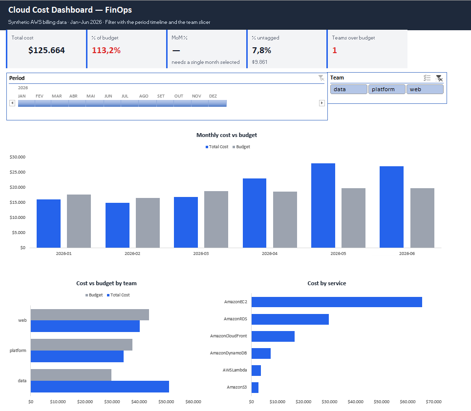
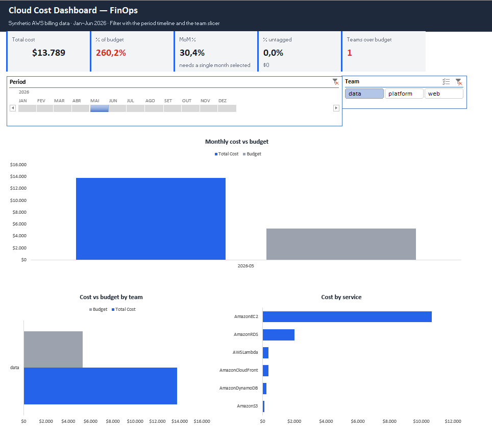
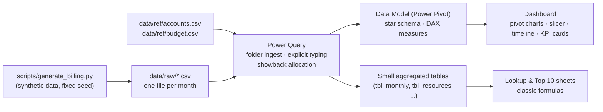
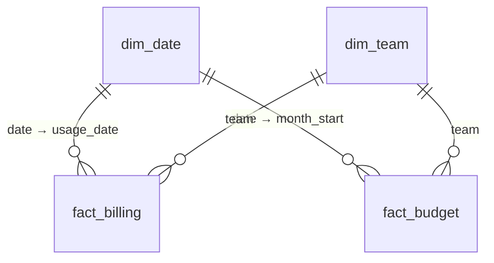

# Cloud Cost Dashboard — FinOps in Excel

An interactive Excel dashboard that answers the questions a FinOps analyst gets every month: **where did the cloud money go, which team spent it, what grew, and who is over budget?**

Monthly AWS billing exports (CSV) are dropped into a folder; one click on **Refresh All** re-runs the whole pipeline: ingestion, cleaning, cost allocation, data model, KPIs and charts.

> **The data is synthetic.** It is generated by [`scripts/generate_billing.py`](scripts/generate_billing.py) with a fixed seed, in a simplified format inspired by the AWS Cost and Usage Report. Three cost anomalies were planted on purpose, so the dashboard has something real to find.



<sub>Full period, no filters.</sub>



<sub>Same dashboard filtered to May 2026 and team *data*: 260% of budget, driven by forgotten GPU-sized instances in a dev environment.</sub>

> **Can't open the workbook?** It needs Excel for Windows with Power Pivot. Without it, the screenshots above and the one-page [PDF export](docs/dashboard.pdf) (anomaly view) show the dashboard as it renders in Excel.
>
> *The screenshots were taken on a pt-BR Windows, so numbers use `.` as thousands separator and `,` for decimals (`$125.664`, `113,2%`), and the timeline shows Portuguese month names.*

---

## What the dashboard finds

| # | Finding | How it shows up |
|---|---|---|
| 1 | **Forgotten GPU instances.** Three expensive EC2 instances in a *dev* environment were started on 10 Apr and never stopped. In under three months they cost **$24,124 (19% of total spend)**. | Team *data* jumps to **211% of budget in April** and ~**260% in May–June**. The Top 10 sheet shows 3 of the 4 most expensive resources in the company are in *dev*, all first seen on 10 Apr. |
| 2 | **A one-week CDN spike.** CloudFront usage for team *web* multiplied by 6 between 12 and 18 May. | Team *web* goes slightly over budget (**102%**) in May only. Filtering May raises *Teams over budget* from 1 to 2. |
| 3 | **Untagged spend.** **7.8% of all cost ($9,861)** has no `team` tag, all of it in the sandbox account. | Allocated to the account owner (*platform*), where it is **~29% of the team's cost**. The share of untagged cost *falls* from 9.8% in January to 6.5% in June (low of 6.3% in May), but not because tagging improved: untagged dollars still grew 12% ($1,573 → $1,760) while total spend grew 69%. That is why the dashboard shows both numbers. |

## Recommendations

1. **Alert on daily cost per environment, not only on the monthly budget.** A daily threshold on dev (or AWS Cost Anomaly Detection) would have flagged the GPU instances, about $290/day, within a day. The monthly budget only exposed them at the end of April. The same alert catches the CloudFront spike.
2. **Auto-shutdown for non-production.** Stop dev and staging outside business hours and give dev resources an expiry date. On the three forgotten instances alone, a 12-hour, 5-day schedule removes roughly two-thirds of the cost (~$15k).
3. **Enforce the `team` tag.** A tag policy that blocks untagged resources, starting with the sandbox account, with a target of less than 2% untagged spend.

---

## Architecture



### Star schema



`fact_billing` is daily per resource; `fact_budget` is monthly per team. Because the two facts have different grains, they are never joined directly. Both are filtered through the shared dimensions, so cost and budget can sit side by side in the same pivot.

---

## How it is built

### 1. Power Query (ETL)
- **Folder ingestion.** All CSVs in `data/raw` are combined automatically, so a new month is just a new file plus Refresh.
- **Explicit typing with the `en-US` locale.** The CSVs use `.` as decimal separator. On a pt-BR Windows, Excel's automatic type detection reads `6000.0` as **60000** (the dot becomes a thousands separator), with no error at all. Automatic type detection is therefore disabled and every numeric column is converted with an explicit locale.
- **Showback allocation.** Rows without a `team` tag are allocated to the team that owns the AWS account (`accounts.csv`). The original tag is kept, and an `allocation` column (`tag` / `account default`) records *how* each dollar was assigned, so untagged spend stays visible as a governance KPI instead of disappearing.
- **Dynamic calendar.** `dim_date` is generated from the min/max billing dates, one row per day with no gaps, as DAX time intelligence requires.

### 2. Data model and DAX

| Measure | DAX |
|---|---|
| Total Cost | `SUM(fact_billing[cost_usd])` |
| Budget | `SUM(fact_budget[budget_usd])` |
| Budget Variance | `[Total Cost] - [Budget]` |
| % of Budget | `DIVIDE([Total Cost], [Budget])` |
| Cost Prev Month | `IF(HASONEVALUE(dim_date[month_key]) && NOT(ISBLANK([Total Cost])), CALCULATE([Total Cost], PREVIOUSMONTH(dim_date[date])))` |
| MoM % | `DIVIDE([Total Cost] - [Cost Prev Month], [Cost Prev Month])` |
| Untagged Cost | `CALCULATE([Total Cost], fact_billing[allocation] = "account default")` |
| % Untagged | `DIVIDE([Untagged Cost], [Total Cost])` |
| Teams Over Budget | `COUNTROWS(FILTER(VALUES(dim_team[team]), [Total Cost] > [Budget]))` |

The `HASONEVALUE` / `ISBLANK` guard on *Cost Prev Month* makes month-over-month blank when it has no meaning: on the grand total, and on future months with no cost yet. A naïve version compares the whole year with itself (0%) and shows a fake −100% for July.

*(The workbook was built in a pt-BR Excel, where DAX uses `;` as argument separator. The formulas above use the standard `,`.)*

### 3. Classic formulas (no data model)
The **Lookup** and **Top 10** sheets answer the same questions with worksheet formulas only, the way a technical Excel test would ask:
- `SUMIFS` for cost by team/month, prior-month cost (`EDATE`) and untagged cost.
- **Two-criteria lookup** with `INDEX/MATCH` as an array formula: `INDEX(budget, MATCH(1, (team=X)*(month=Y), 0))`.
- **Top 10 resources** with `LARGE` + `MATCH` + `INDEX`, computed once per row in a helper column and reused by the other columns.
- Data-validation dropdowns fed by `INDIRECT("tbl_team[team]")`, so the lists grow with the tables.

### 4. Dashboard
- Pivot charts fed by a hidden `calc` sheet: cost vs budget by month, cost vs budget by team, and cost by service. Cost is always blue and budget always gray, and every value axis starts at zero.
- One **team slicer** and one **timeline**, both connected to every pivot table.
- KPI cards read the pivots with `GETPIVOTDATA`, by measure name rather than cell position, so they survive layout changes. `GETPIVOTDATA` returns 0 for a blank measure, so the MoM card uses `IFERROR(1/(1/GETPIVOTDATA(...)), "—")` to show a dash instead of a fake 0%.
- Conditional formatting: % of budget is green up to 100% and red above it; *Teams over budget* turns red when it is above zero; *dev* resources are highlighted in the Top 10.

---

## Validation

- **Reconciliation with the source.** The model holds 9,658 rows and **$125,664.08**, matching the raw CSVs to the cent (hidden `_checks` sheets).
- **Two independent implementations.** Every figure on the Lookup sheet (`SUMIFS`, `INDEX/MATCH`) matches the DAX measures for the same filters, e.g. team *data*, April 2026: $10,572.99 cost, $5,000 budget, 211.5%, +134.9% MoM.

---

## How to run

**Requirements:** Excel for Windows with Power Pivot (Excel 2016/2019 Professional Plus or Microsoft 365). Python 3 with the standard library only.

```bash
git clone https://github.com/vitoraugustotrad-hub/finops-excel-dashboard.git
cd finops-excel-dashboard
python scripts/generate_billing.py   # optional: the CSVs are already in data/
```

1. Open `finops_dashboard.xlsx`.
2. **Data → Get Data → Launch Power Query Editor → Manage Parameters** and replace the placeholder value of `DataFolder` (`C:\path\to\finops-excel-dashboard\data`) with the full path of this repo's `data` folder.
3. **Data → Refresh All.**

To simulate a new month, extend `MONTHS` in the script, re-run it and refresh: every sheet updates.

---

## Limitations

- **Synthetic data.** The patterns are planted, not discovered in a real bill.
- **Budget is monthly.** It is linked to the first day of each month, so it is only meaningful at month level or above.
- **Top 10 ties.** If two resources had exactly the same cost, `MATCH` would return the first one twice. This cannot happen with these 4-decimal costs, but it would need a tie-breaker on real data.
- **Windows only.** Power Pivot is not available in Excel for Mac or Excel for the web.

## Repository structure

```
├── finops_dashboard.xlsx      # the workbook
├── scripts/
│   └── generate_billing.py    # synthetic data generator (seed 42)
├── data/
│   ├── raw/                   # monthly billing exports
│   └── ref/                   # accounts → team mapping, budget
└── docs/                      # screenshots and PDF export
```

---

**Vitor Augusto Victório** · [GitHub](https://github.com/vitoraugustotrad-hub) · [LinkedIn](https://www.linkedin.com/in/vitor-augusto-victorio/)
